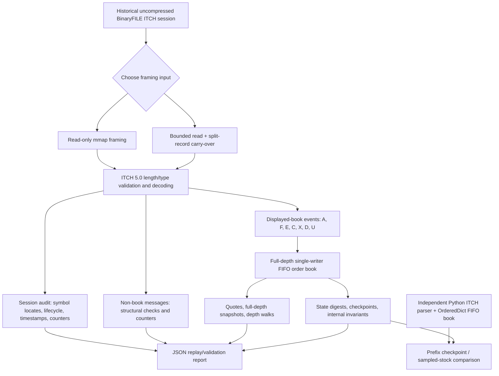

# Aster Market Engine architecture

Aster is a single-writer, offline C++20 **displayed limit-order-book reconstruction** engine for historical Nasdaq TotalView-ITCH 5.0 BinaryFILE recordings. It is not an exchange gateway, matching engine, backtester, hidden-liquidity estimator or execution simulator.

## Data flow



## Internals

**Input and decoder.** A historical BinaryFILE record has a two-byte big-endian length prefix; the ITCH payload begins after that prefix. Mapped and buffered readers use separate framing implementations but the same C++ event decoder. Supported known message types are length-checked, including structural handling of non-book records. Malformed, truncated and contradictory inputs fail with offsets; they are not silently skipped.

**Session audit.** Nasdaq stock locates are session-scoped. `R` directory messages establish locate-to-symbol mappings and are checked against `A`/`F` stock fields; system `S` events establish session opening and closing. Exactly identical directory-body reannouncements are counted; changed mappings and metadata are rejected. Complete-session mode requires open/close events and rejects timestamp regressions.

**FIFO reconstruction.** `Book` stores a numeric reference index for live orders and sorted bid/ask price-level structures, each with an observed-order FIFO list. `A`/`F` append, `E`/`C`/`X` reduce without changing priority, `D` removes, and `U` replaces a reference and rejoins at the back. Fixed-point prices use units of 1/10,000. A walk over visible depth is not a fill prediction.

**Verification.** Independent C++ framing paths, seeded generated fixtures, a negative-protocol matrix, sanitizers, Clang fuzz smoke tests and a separately written Python decoder and `OrderedDict` FIFO model exercise different classes of errors. Reference comparisons check exact full-depth queue state for selected symbols and whole-book fingerprints at prefix checkpoints. Hashes are deterministic and FIFO-sensitive, but not cryptographic proof of exchange truth.

## Reproducible commands

```bash
cmake -S . -B build-release -DCMAKE_BUILD_TYPE=Release
cmake --build build-release --parallel 2
ctest --test-dir build-release --output-on-failure

./build-release/aster-replay /path/to/uncompressed.itch \
  --io read --chunk 65536 --audit --complete --validate

python3 tools/verify_prefix.py /path/to/uncompressed.itch \
  --binary build-release/aster-replay --limit 20000000 \
  --checkpoint-interval 2000000

python3 tools/verify_symbol.py /path/to/uncompressed.itch \
  --binary build-release/aster-replay --symbol AAPL --limit 120000000
```

For measurements and precise limitations, see [the real-feed performance report](real-feed-performance-2026-10-25.md), [the actual session replay](real-feed-replay-2026-10-25.md), and [engineering notes](engineering.md).
